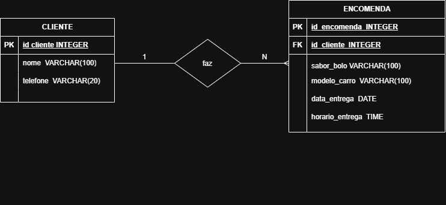

#  Sistema Bolos da Neide
Este repositório contém o projeto desenvolvido para o cliente Bolos da Neide.

O objetivo do sistema é auxiliar no gerenciamento de pedidos de bolos, permitindo registrar informações dos clientes, como nome e telefone, além dos pedidos, sabores escolhidos e datas de entrega.

## MER — Bolos da Neide

### 1.Entidades
Cliente: armazena os dados dos clientes que fazem encomendas de bolos.
Encomenda: armazena as informações dos pedidos de bolos.
### 2.Atributos
Cliente:
id_cliente — identificador do cliente (PK).
nome — nome do cliente.
telefone — telefone do cliente.
Encomenda:
id_encomenda — identificador da encomenda (PK).
id_cliente — identificador do cliente (FK).
sabor_bolo — sabor do bolo encomendado.
data_entrega — data de entrega do bolo.
horario_entrega — horário de entrega do bolo.
### 3.Relacionamento
Um cliente pode fazer várias encomendas.
Cada encomenda pertence a um único cliente.
A cardinalidade do relacionamento é 1:N (um para muitos).
### 4.Regras de negócio
Cada cliente possui um identificador único.
Cada encomenda possui um identificador único.
Toda encomenda deve estar vinculada a um cliente cadastrado.
O sabor do bolo e a data de entrega devem ser registrados em cada encomenda.
O sistema deve permitir registrar o horário de entrega, caso esse requisito tenha sido confirmado na entrevista com a Dona Neide.

## Diagrama DER

